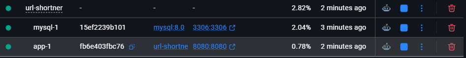
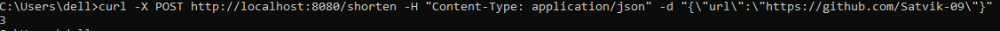
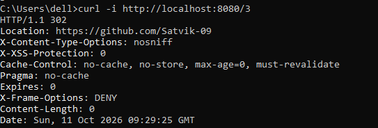
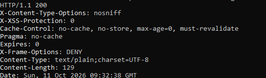
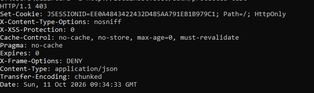
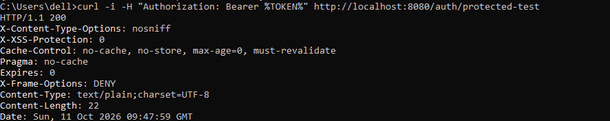
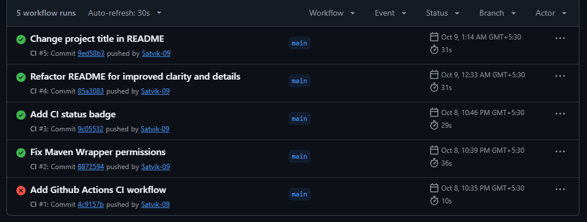

<h1 align="center">ShortLink</h1>

<p align="center"><strong>Secure URL Shortening Service</strong></p>

<p align="center">
Spring Boot REST backend with Base62 short codes, JWT authentication, Docker Compose deployment and automated CI.
</p>

<p align="center">
 [](https://github.com/Satvik-09/URL-Shortener-Analytics/actions/workflows/ci.yml) 
  
  
  
  
</p>

---

## Contents

- [Overview](#overview)
- [Key Features](#key-features)
- [Tech Stack](#tech-stack)
- [System Architecture](#system-architecture)
- [How Short Codes Work](#how-short-codes-work)
- [Authentication Flow](#authentication-flow)
- [API Reference](#api-reference)
- [Getting Started](#getting-started)
- [Configuration](#configuration)
- [Testing and CI](#testing-and-ci)
- [Design Decisions](#design-decisions)
- [Known Limitations and Roadmap](#known-limitations-and-roadmap)
- [Author](#author)

---

## Overview

ShortLink converts long URLs into compact, unique short codes and redirects visitors to the original address. The backend is layered (controller, service, repository), secured with stateless JWT authentication, containerized with Docker Compose alongside a persistent MySQL database, and verified by unit tests that run automatically on every push through GitHub Actions.

## Demo

| Step | Screenshot |
|---|---|
| Application and MySQL running in Docker |  |
| Shorten a URL |  |
| Redirect to the original URL |  |
| Login returns a JWT |  |
| Protected route without a token is rejected |  |
| Protected route with a token succeeds |  |
| CI passing on GitHub Actions |  |


## Key Features

| Area | Details |
|---|---|
| URL shortening | Short codes generated by Base62-encoding the database-assigned ID, with redirect handling |
| Authentication | Registration and login with BCrypt-hashed passwords; stateless JWT with a one-hour lifetime |
| Request security | A custom filter validates the Bearer token on every request; invalid or missing tokens are rejected on protected routes |
| Validation | Bean Validation on request DTOs, with field-level error messages |
| Error handling | A global exception handler returns consistent JSON error bodies |
| Containerization | Multi-stage Dockerfile and Docker Compose running the app with MySQL on a named volume |
| Quality | JUnit 5 and Mockito unit tests, executed by a GitHub Actions workflow on every push and pull request |

## Tech Stack

| Layer | Technology |
|---|---|
| Language and framework | Java 21, Spring Boot 4.1.1 |
| Security | Spring Security, jjwt, BCrypt |
| Persistence | Spring Data JPA, Hibernate, MySQL 8 (Docker), H2 (local development) |
| Build and packaging | Maven, Docker, Docker Compose |
| Testing and CI | JUnit 5, Mockito, GitHub Actions |

## System Architecture

```
Client request
      |
      v
JwtFilter ............ reads the Authorization header and validates the Bearer token
      |
      v
SecurityConfig ....... decides whether the route is public or requires authentication
      |
      v
Controller ........... maps HTTP to service calls
      |
      v
Service .............. business logic (short code generation, lookup)
      |
      v
Repository ........... data access through Spring Data JPA
      |
      v
MySQL

GlobalExceptionHandler wraps the controller, service and repository layers
and converts exceptions into JSON error responses.
```

| Component | Responsibility |
|---|---|
| `JwtFilter` | Identifies who is making the request. It never rejects a request itself. |
| `SecurityConfig` | Decides what each route requires: public or authenticated |
| `JwtUtil` | Generates, parses and validates tokens |
| `GlobalExceptionHandler` | Maps exceptions to consistent error responses |

## How Short Codes Work

Short codes are the Base62 representation of the row ID that the database assigns on insert. The alphabet is `0-9`, `a-z`, `A-Z` (62 symbols).

| Database ID | Short code |
|---|---|
| 1 | `1` |
| 125 | `21` |
| 1000 | `g8` |

Creation takes two writes. The first save inserts the row and returns the generated ID. The service encodes that ID and saves the row again with the short code. Because database IDs are unique and Base62 encoding is a one-to-one conversion, two URLs can never receive the same code, so no collision-handling logic is needed. The conversion is also reversible, so a code can be decoded back to its ID.

## Authentication Flow

1. `POST /auth/register` stores the user with a BCrypt-hashed password.
2. `POST /auth/login` verifies the password against the stored hash and returns a signed JWT.
3. The client sends `Authorization: Bearer <token>` on later requests.
4. `JwtFilter` checks the token's signature and expiry. A valid token authenticates the request.
5. `SecurityConfig` then decides whether the requested route needs authentication. Protected routes return `403` for missing or invalid tokens.

## API Reference

| Method | Endpoint | Auth | Request body | Response |
|---|---|---|---|---|
| POST | `/auth/register` | None | `{"username": "...", "password": "..."}` | `200` confirmation message |
| POST | `/auth/login` | None | `{"username": "...", "password": "..."}` | `200` with JWT; `401` for invalid credentials |
| POST | `/shorten` | None | `{"url": "https://..."}` | `200` with the short code; `400` for invalid input |
| GET | `/{code}` | None | None | `302` redirect to the original URL |
| GET | `/protected-test` | Bearer token | None | `200` when authenticated; `403` otherwise |

Validation failures return field-level messages, for example:

```json
{ "url": "URL cannot be Empty" }
```
### Error Responses

| Situation | Status | Body |
|---|---|---|
| Empty or malformed URL | 400 | `{"url": "URL cannot be Empty"}` |
| Wrong username or password | 401 | `Invalid Credentials` |
| Missing or invalid token on a protected route | 403 | empty |
| Unknown short code | 404 | `{"error": "No URL found for code: abc"}` |

## Getting Started

### Prerequisites

- Docker Desktop
- Java 21 (only needed to run without Docker)

### Run with Docker Compose

```bash
git clone https://github.com/Satvik-09/URL-Shortener-Analytics.git
cd URL-Shortener-Analytics
docker-compose up --build
```

The API is then available at `http://localhost:8080`. Database data lives in a named Docker volume.

```bash
docker-compose down       # stop containers, keep data
docker-compose down -v    # stop containers and delete the database volume
```

After changing code, run `docker-compose up --build` again. Images are snapshots, so a rebuild is required for changes to take effect.

### Run locally without Docker

```bash
./mvnw spring-boot:run
```

This uses an in-memory H2 database, so data resets on every restart.

### Try it

```bash
# Register and log in
curl -X POST http://localhost:8080/auth/register \
  -H "Content-Type: application/json" \
  -d '{"username": "demo", "password": "pass123"}'

curl -X POST http://localhost:8080/auth/login \
  -H "Content-Type: application/json" \
  -d '{"username": "demo", "password": "pass123"}'

# Shorten a URL
curl -X POST http://localhost:8080/shorten \
  -H "Content-Type: application/json" \
  -d '{"url": "https://www.example.com"}'

# Call a protected route with the token from login
curl -H "Authorization: Bearer <token>" http://localhost:8080/protected-test
```
### Troubleshooting

| Symptom | Cause | Fix |
|---|---|---|
| Port 8080 already in use | Another instance is running | Stop it, or change the host port in `docker-compose.yml` |
| Code changes do not appear in the container | Images are snapshots | Run `docker-compose up --build` |
| Users disappear after a restart | Running locally on in-memory H2 | Use Docker Compose, which stores data in a MySQL volume |
| Docker Desktop will not start on Windows | WSL 2 or virtualization is not enabled | Enable virtualization, enable the WSL and Virtual Machine Platform features, run `wsl --update` |
| Connection error on first Compose start | MySQL is still initializing | Wait a few seconds and retry |

## Configuration

The application reads its database settings from environment variables, which `docker-compose.yml` supplies.

| Variable | Purpose | Value in Compose |
|---|---|---|
| `SPRING_DATASOURCE_URL` | JDBC connection URL | `jdbc:mysql://mysql:3306/urlshortener` |
| `SPRING_DATASOURCE_USERNAME` | Database user | `root` |
| `SPRING_DATASOURCE_PASSWORD` | Database password | set in `docker-compose.yml` |

Inside the Compose network the app reaches the database through the service name `mysql`, not `localhost`. The credentials in the Compose file are for local development only.

## Testing and CI

```bash
./mvnw test
```

| Test class | What it verifies |
|---|---|
| `Base62Test` | Encode and decode round trip |
| `UrlServiceTest` | Short code generation and the unknown-code case, with the repository mocked |
| `JwtUtilTest` | Token generation and validation, and rejection of tampered tokens |

A GitHub Actions workflow (`.github/workflows/ci.yml`) runs on every push to `main` and on every pull request targeting `main`. It checks out the code, installs JDK 21 and runs the test suite. Changes are developed on feature branches and merged through pull requests that reference an issue.

## Design Decisions

- **Base62 of the database ID instead of random strings.** Uniqueness comes from the database, so no collision checks or retries are needed, and codes stay short.
- **DTOs separate from entities.** Clients can only supply the fields an endpoint expects, so they cannot set internal fields such as IDs or short codes.
- **The filter identifies, the configuration decides.** `JwtFilter` establishes who is calling, and `SecurityConfig` decides what each route requires. Neither depends on the other's logic.
- **Stateless authentication.** The server stores no sessions, because the signed token carries the proof of identity.
- **Multi-stage Docker build.** The first stage compiles with Maven and a JDK, and the final image contains only a JRE and the JAR.
- **Named volume for MySQL.** Data survives container restarts and rebuilds.

## Known Limitations and Roadmap

- The JWT signing secret is currently defined in source. It should move to an environment variable or a secrets manager.
- Roles are stored per user but are not yet loaded into the security context, so role-restricted routes are not enforced.
- Planned: click analytics per short link, Redis caching for redirect lookups, refresh tokens, rate limiting on `/shorten`, and cloud deployment.

## Author

Satvik, [GitHub](https://github.com/Satvik-09)